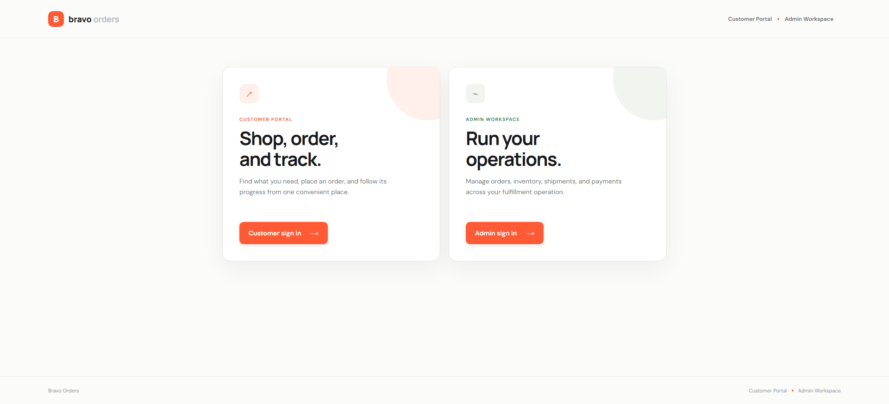
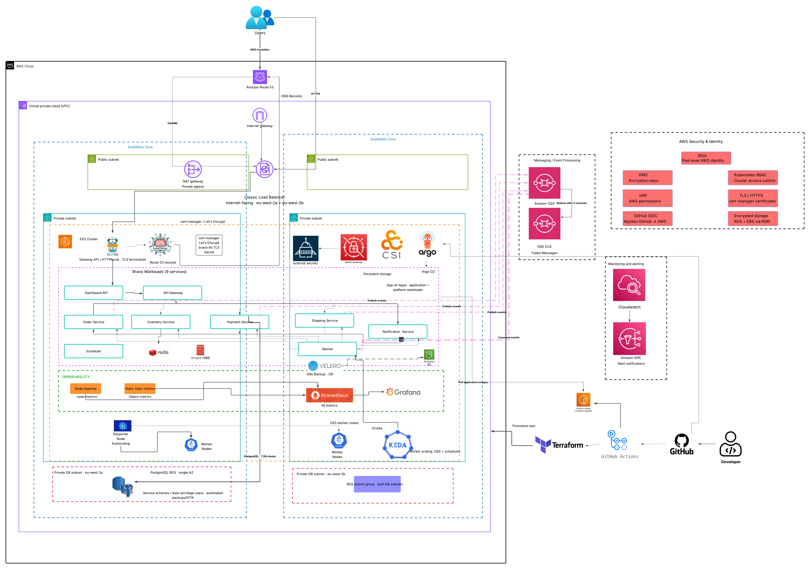

# BRAVO EKS

BRAVO is a production-oriented e-commerce and order-management platform built as nine Go microservices on Amazon EKS. The repository covers the application, AWS infrastructure, Kubernetes platform, delivery pipelines, security, observability, and recovery controls used to operate the system in DEV and PROD.

The project uses Terraform for AWS infrastructure, Helm for Kubernetes packaging, GitHub Actions for build and infrastructure workflows, and Argo CD for GitOps reconciliation.



[https://shop.bravoorders.com/](https://shop.bravoorders.com/)

## Project at a glance

| Area | Implementation |
|---|---|
| Cloud and region | AWS, `eu-west-2` |
| Runtime | Amazon EKS and nine Go microservices |
| Infrastructure | Terraform modules with separate DEV and PROD roots and state |
| Delivery | GitHub Actions, Amazon ECR, Helm, and Argo CD |
| Ingress | Route 53, one internet-facing Classic Load Balancer, Traefik, and Gateway API |
| Data | Private Amazon RDS for PostgreSQL and Redis |
| Events | Amazon SQS, a dead-letter queue, and Worker consumers |
| Scaling | Karpenter, HPA, and KEDA |
| Observability | Prometheus, Grafana, kube-state-metrics, node exporter, Alertmanager, and CloudWatch |
| Recovery | Velero with S3/EBS snapshots, plus separate RDS automated backups and PITR |

## Architecture



Production runs in a VPC across `eu-west-2a` and `eu-west-2b`. Each Availability Zone has a public subnet, a private application subnet, and a dedicated private database subnet. EKS workloads run in the private application subnets. The RDS subnet group spans both private database subnets; the current PostgreSQL instance is private and single-AZ.

The public request path is:

```text
Users
  ├─ DNS lookup → Route 53
  └─ HTTPS → one internet-facing Classic Load Balancer
                 → Traefik (TLS termination)
                 → Kubernetes Gateway API / HTTPRoute
                 → Dashboard API
                 → API Gateway and domain services
```

Route 53 resolves DNS records; it does not proxy application traffic. The deployed PROD load balancer is one **Classic Load Balancer** spanning both Availability Zones, not an ALB, NLB, or GWLB. The Internet Gateway supplies VPC network connectivity and is not an application-layer request hop.

## Application and data flow

| Service | Role |
|---|---|
| `dashboard-api` | Serves the customer/admin UI and proxies application requests |
| `api-gateway` | Validates protected requests, applies Redis-backed rate limits, and routes to domain services |
| `order-service` | Owns order creation and lifecycle state |
| `inventory-service` | Manages products, stock, and reservations |
| `payment-service` | Records simulated charges, refunds, and ledger entries |
| `shipping-service` | Manages shipments and tracking events |
| `notification-service` | Persists customer notifications and notification templates |
| `worker` | Consumes SQS events and coordinates asynchronous domain work |
| `scheduler` | Runs recurring database maintenance and reporting jobs |

Customer requests enter through the Dashboard API and API Gateway, then reach the relevant domain service. Order, payment, and shipping events are published to SQS. The Worker consumes those events and coordinates inventory, payment, shipping, notification, and order-status actions. Failed messages are retried and can move to the DLQ through the queue redrive policy. See the [detailed customer and order flow](docs/architecture/application-flow.md).

PostgreSQL runs on Amazon RDS in the dedicated private DB subnet layer. Stateful services use separate schemas, database users, and Secrets Manager entries; the Scheduler and Dashboard have explicit cross-schema read/write grants for their verified duties. Redis provides API Gateway rate-limit state. See the [RDS permission matrix](docs/architecture/rds-permission-matrix.md) and [database connectivity runbook](docs/runbooks/rds-database-connectivity.md).

## Infrastructure and environment separation

Terraform provisions the VPC, public/private/application/database subnets, NAT and Internet gateways, EKS, ECR, RDS, SQS/DLQ, IAM roles, CloudWatch alarms, and Velero S3 storage. Reusable components are under [`terraform/modules/`](terraform/modules/).

| Concern | DEV | PROD |
|---|---|---|
| AWS boundary | Dedicated development account | Dedicated production account |
| Terraform root | `terraform/environments/dev/` | `terraform/environments/prod/` |
| Terraform state | DEV S3 backend and key | Separate PROD S3 backend and key |
| Helm values | `kubernetes/helm/service-values-dev/` | `kubernetes/helm/service-values-prod/` |
| Argo CD tree | `kubernetes/argocd/applications-dev/` | `kubernetes/argocd/applications-prod/` |
| Reconciliation | Automated prune and self-heal | Manual synchronization in the checked-in PROD applications |
| Image publishing | Explicit DEV target | Explicit manual PROD target |

Bootstrap stacks are also separated under `terraform/bootstrap-dev/` and `terraform/bootstrap-prod/`. GitHub Actions validates the selected environment, IAM role, AWS account, ECR registry, and Terraform directory before operating.

## CI/CD and GitOps

GitHub Actions and Argo CD have separate responsibilities:

- **GitHub Actions** detects changed services, builds and scans container images, publishes explicitly selected images to ECR, and runs Terraform format, security, validation, plan, and manually triggered deployment workflows.
- **Argo CD** reads the environment-specific Helm configuration from Git and reconciles Kubernetes applications and platform components. EKS workloads then pull the referenced images from ECR.

Production image publication and Terraform deployment require an explicit manual environment selection. Terraform deployment applies the saved plan from the same workflow run. See [GitHub Actions pipelines](docs/architecture/github-actions-pipelines.md) and the checked-in [workflow definitions](.github/workflows/).

## Platform services

### Ingress and TLS

ExternalDNS manages Route 53 records through IRSA. The current Classic Load Balancer exposes Traefik, which implements the Kubernetes Gateway API. `HTTPRoute` sends public application traffic to the Dashboard API. cert-manager obtains Let’s Encrypt certificates, and Traefik terminates HTTPS with the Kubernetes TLS secret.

### Secrets management

Runtime and database credentials follow this path:

```text
AWS Secrets Manager → External Secrets Operator → Kubernetes Secret → workload
```

External Secrets Operator authenticates with IRSA and synchronizes only the configured secret properties. Source-controlled Helm values reference secret names and properties rather than embedding credentials.

### Autoscaling

- **Karpenter** supplies EKS worker-node capacity for application workloads.
- **HPA** provides resource-based pod scaling where enabled; PROD currently enables it for the API Gateway.
- **KEDA** scales the Worker from SQS queue depth and configured schedules.

### Observability and alerting

Prometheus collects cluster metrics, including kube-state-metrics and node-exporter data, while Grafana provides dashboards. Alertmanager is deployed with the Kubernetes monitoring stack. CloudWatch alarms cover RDS CPU/storage and SQS queue/DLQ depth. The [SQS monitoring runbook](docs/runbooks/sqs-monitoring.md) records the existing SNS alerting path; this repository does not define an SNS subscription, so no email or other delivery channel is claimed here.

### Backup and recovery

Velero schedules Kubernetes namespace backups to encrypted, versioned S3 buckets and supports EBS CSI snapshots. RDS uses its own automated backup retention and point-in-time recovery capability. Velero does **not** back up RDS.

## Security controls

- Private EKS application subnets and dedicated private DB subnets with no Internet route.
- RDS is not publicly accessible and accepts PostgreSQL traffic through its security-group path from EKS.
- GitHub OIDC provides short-lived AWS access for workflows; IRSA provides pod-level roles for services and controllers.
- AWS Secrets Manager and External Secrets Operator keep application/database credentials out of manifests.
- EKS secret encryption and RDS storage encryption use AWS KMS; SQS and Velero S3 storage are encrypted.
- Kubernetes `NetworkPolicy` resources restrict service ingress and egress; workload values also apply non-root/container hardening and disruption controls where configured.
- cert-manager and Let’s Encrypt provide HTTPS, terminated at Traefik.

## Local development

Prerequisites: Docker, Docker Compose, and Git.

```bash
git clone https://github.com/bravo-eks/bravo-eks.git
cd bravo-eks
cp .env.example .env
docker compose up --build
```

Review `.env` before starting and never commit credentials. Useful commands:

```bash
docker compose ps
docker compose logs -f <service-name>
docker compose down
docker compose down -v  # also remove local volumes
```

## Repository structure

```text
.
├── .github/workflows/           # Container and Terraform workflows
├── docs/                        # Architecture, runbooks, and verification notes
├── images/                      # Final architecture diagram
├── kubernetes/
│   ├── argocd/                  # DEV/PROD GitOps application trees
│   ├── helm/                    # Shared charts and environment values
│   └── platform/                # Traefik, cert-manager, monitoring, scaling, backups
├── services/                    # Nine Go microservices
├── terraform/
│   ├── bootstrap-dev/           # DEV state and GitHub OIDC bootstrap
│   ├── bootstrap-prod/          # PROD state and GitHub OIDC bootstrap
│   ├── environments/{dev,prod}/ # Environment roots and state configuration
│   └── modules/                 # Reusable AWS modules
├── docker-compose.yml
└── .env.example
```

## Documentation

| Document | Purpose |
|---|---|
| [Application flow](docs/architecture/application-flow.md) | Customer/admin journeys, service interactions, events, and current limitations |
| [GitHub Actions pipelines](docs/architecture/github-actions-pipelines.md) | Environment targeting, image publication, and Terraform workflows |
| [RDS permission matrix](docs/architecture/rds-permission-matrix.md) | Service schemas, users, and database permissions |
| [RDS connectivity runbook](docs/runbooks/rds-database-connectivity.md) | Diagnosing secrets, connectivity, authentication, and grants |
| [SQS monitoring runbook](docs/runbooks/sqs-monitoring.md) | Queue/DLQ alarms and verified alerting path |
| [DEV infrastructure health check](docs/tests/dev-infrastructure-health-check.md) | Recorded infrastructure and cluster verification |

Service-level READMEs are available under [`services/`](services/). Kubernetes, Argo CD, Helm, and Terraform directories remain the source of truth for implementation details not covered by a dedicated guide.

## License

See [LICENSE](LICENSE).
