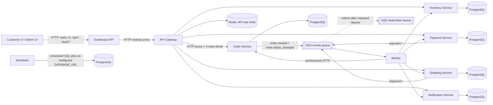
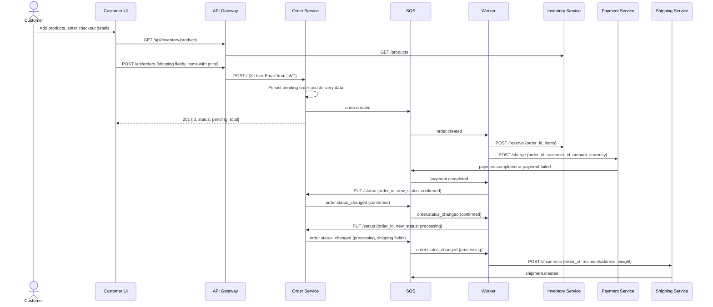
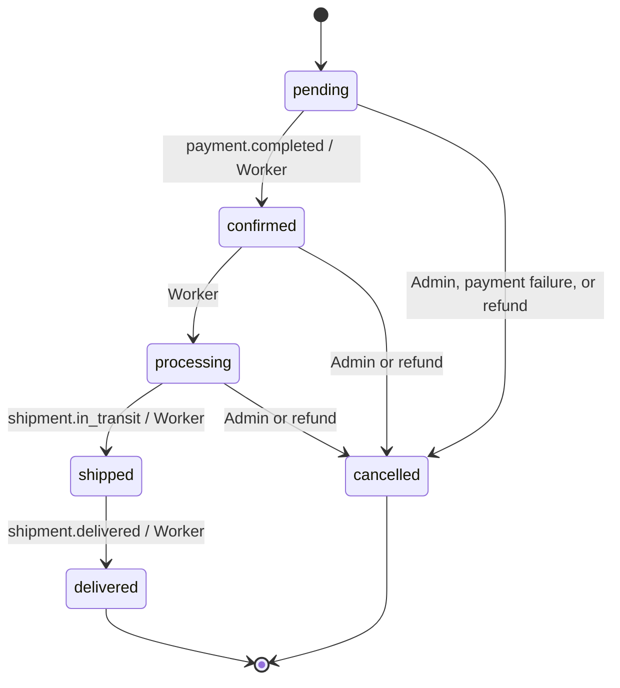
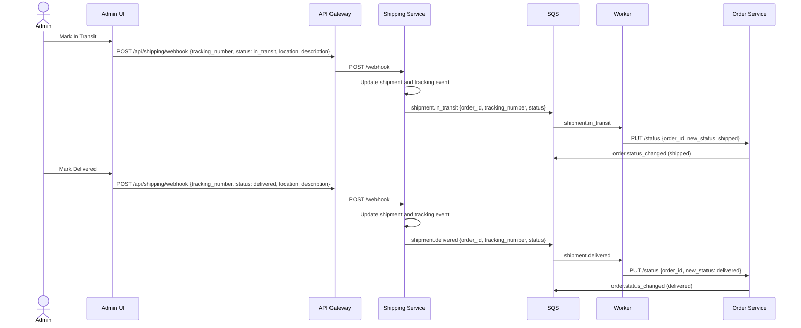

# Bravo Orders application flow

This guide describes the current implementation of the Customer and Admin order flows, their service interactions, and the relevant persistence and event behavior. It is based on the service and frontend code, including the current demo-specific behavior and limitations.

## 1. Architecture overview

The Dashboard API serves the static Customer and Admin UI and proxies `/api/*` and `/auth/*` requests to the API Gateway. For protected API paths, the Gateway validates bearer tokens, applies Redis-backed request limits, forwards the caller identity to services, and proxies to the domain services. Authentication routes and the shipping webhook are public paths in the current implementation.

HTTP calls are synchronous: checkout to Order Service, Worker calls to downstream services, Admin shipping actions to Shipping Service, and browser reads/actions through the Gateway. Order, payment, and shipment events are asynchronous: their services publish a common event envelope to SQS, and the Worker long-polls the configured queue.



### Component ownership

| Component | Responsibility in this flow |
|---|---|
| Customer UI | Loads the live catalogue, maintains a basket, collects checkout details, submits orders, and displays order/refund state. |
| Admin UI | Loads the Admin order list and shipments, displays order details/actions, and manages refund requests. |
| Dashboard API | Serves the static UI, proxies `/api/` and `/auth/` to the Gateway, and implements dashboard summary endpoints. |
| API Gateway | Routes requests, validates JWTs on protected paths, forwards the JWT subject in `X-User-Email`, and uses Redis for request rate limits. |
| Order Service | Owns order records, order totals, shipping fields stored with orders, and allowed order status transitions. Publishes order events. |
| Inventory Service | Owns product stock and reservations. It reserves and releases available quantities transactionally. |
| Payment Service | Owns payment rows, refund requests, and ledger entries. It simulates charge/refund processing and publishes payment events. |
| Shipping Service | Owns shipment records and tracking events. Its webhook endpoint changes shipment state and publishes shipment events. |
| Notification Service | Renders configured templates and persists notifications. Email/SMS delivery is simulated, not sent through a provider. |
| Worker | Consumes SQS events and coordinates synchronous HTTP calls among domain services. |
| Scheduler | Runs recurring SQL maintenance and reporting jobs against its configured PostgreSQL database. |
| PostgreSQL | Persists domain records and event/audit data. Services connect using their configured `DATABASE_URL`. |
| Redis | Used by the API Gateway for a per-client-IP request counter and rate limiting; it is not the source of order or refund state. |
| SQS / DLQ | Carries asynchronous domain events. Failed Worker messages remain available for redelivery and can be moved to the configured DLQ by the queue redrive policy. |

The local database initialization script creates `order_db`, `inventory_db`, `payment_db`, and `shipping_db`. Runtime services use `DATABASE_URL`; the connection target is configuration, not inferred from the service name in this guide.

The Gateway's proxy limiter increments `rate:<client-ip>`, sets a one-minute expiry on the first request, and rejects counts above 100 in that window. SQS event messages use an envelope of `type`, `payload`, and UTC `timestamp`. The Worker receives up to 10 messages using long polling (20 seconds by default) and a 60-second visibility timeout by default. It deletes a message only after successful handling. Errors leave it for retry; this is at-least-once delivery, so not every handler is automatically exactly-once.

The LocalStack setup creates `order-events` and `order-events-dlq` with a redrive count of 3. The Terraform SQS module creates the environment event queue and its DLQ; its default `max_receive_count` is 5 unless overridden.

Scheduler jobs run once at startup and then on their configured intervals: reservation expiry every minute, abandoned pending-order detection every 5 minutes, failed-payment inspection every 15 minutes, digest logging every hour, and old order-event cleanup every 30 minutes. The failed-payment job currently counts eligible rows and logs a placeholder rather than retrying charges; the digest job logs its summary rather than sending a notification.

## 2. Customer order flow

The Customer UI obtains products from `GET /api/inventory/products`. Basket entries retain product identity and quantity; checkout rechecks the product and current available stock before submitting. The price comes from the live product record.

The frontend sends `POST /api/orders` with a JSON body shaped like:

```json
{
  "customer_id": "customer@bravoorders.com",
  "recipient_name": "<checkout full name>",
  "address_line1": "<checkout address>",
  "city": "<checkout city>",
  "postcode": "<checkout postcode>",
  "country": "<checkout country>",
  "items": [
    {
      "product_id": "<catalogue product id>",
      "quantity": 1,
      "price": 25.99
    }
  ]
}
```

The Customer frontend currently does not send `address_line2`, `weight_kg`, or an order-level `currency`. Order Service defaults a blank country to `GB`, a non-positive/missing weight to `1.0`, and a missing currency to `GBP`. It calculates the order total by summing `price * quantity` from the submitted items. The body’s `customer_id` is not authoritative: Order Service requires and uses `X-User-Email`, which the Gateway sets from the JWT subject.

On successful creation, Order Service persists a `pending` order and its delivery fields, records an order event, publishes `order.created`, and returns the new order ID and pending status. The Worker handles the event asynchronously:

1. It posts the order items to Inventory Service `/reserve`.
2. It posts the order ID, customer ID, total, currency, and method `worker` to Payment Service `/charge`.
3. It asks Notification Service to persist an order-confirmation notification.
4. Payment Service emits either `payment.completed` or `payment.failed`. The Worker handles that event separately.

On `payment.completed`, the Worker requests `confirmed` from Order Service. That service publishes `order.status_changed`; the Worker reacts to `confirmed` by requesting `processing`. The resulting `order.status_changed` contains the persisted shipping fields. When the Worker consumes the `processing` event, it posts those fields to Shipping Service to create the shipment.



Payment Service currently simulates charge success with a 90% success branch and a 10% failure branch. A successful charge is persisted with its ledger entries before the payment event is published.

## 3. Order status lifecycle

Order Service is authoritative for transitions submitted to its status endpoint. Its transition table is:



| Transition | Cause |
|---|---|
| `pending -> confirmed` | Worker handles `payment.completed` and calls Order Service. |
| `confirmed -> processing` | Worker handles `order.status_changed` with `new_status=confirmed` and calls Order Service. |
| `processing -> shipped` | Worker handles `shipment.in_transit` and calls Order Service. |
| `shipped -> delivered` | Worker handles `shipment.delivered` and calls Order Service. |
| `pending`, `confirmed`, or `processing -> cancelled` | Admin cancellation or Worker handling payment failure/refund. |

`delivered` and `cancelled` have no outgoing transitions. A refund does not allow cancellation once an order is shipped or delivered.

There is also a Scheduler path that directly updates orders stuck in `pending` for more than 30 minutes to `cancelled`. It writes SQL directly rather than calling Order Service, so it does not publish `order.status_changed` and does not invoke the Worker inventory-release path. See [Section 12](#12-cancellation-flow).

## 4. Customer My Orders

Customer My Orders calls `GET /api/orders` without `all=true`. The Gateway validates the bearer token, reads its `sub` claim, and forwards that identity as `X-User-Email`. Order Service applies `customer_id = X-User-Email` when the header is present. The frontend also filters returned orders to the current demo Customer identity before rendering.

The view shows the order's current status from Order Service and the lifecycle tracker. It separately loads `GET /api/payments/payments` and `GET /api/payments/refund-requests` to associate persisted payment/refund information for display and refund eligibility.

## 5. Admin Orders

Admin `loadLive()` calls `GET /api/orders?all=true`, plus the existing inventory, shipment, and payment-ledger endpoints. Order Service skips only the `X-User-Email` predicate when the query parameter is exactly `all=true`; without it, normal identity filtering remains. The endpoint still sorts newest-first and applies `LIMIT 100`, so the current implementation returns at most the latest 100 orders, not an unbounded history.

This is demo functionality, not production RBAC: any caller whose request reaches Order Service with `all=true` bypasses the customer filter. The Gateway does not enforce an Admin role for this query.

Admin order state is held in frontend `state.orders`. The Orders table and drawer read this array; the drawer finds the order by ID and matches its shipment from `state.shipments` by `order_id`. The Admin Orders sidebar badge and the Orders “All” tab count are both set from `state.orders.length` by `renderOrderCounts()`. Since `loadLive()` calls `renderAll()` after refreshing `state.orders`, both counts update after the live request. They represent the current response length, subject to the 100-order API cap.

## 6. Shipping flow

When the Worker receives an `order.status_changed` event with `new_status=processing`, it posts to Shipping Service `/shipments` with:

- `order_id`
- `carrier` (defaults to `royal_mail` in the Worker)
- `recipient_name`
- `address_line1`
- `address_line2`
- `city`
- `postcode`
- `country`
- `weight_kg` when present

Order Service includes its persisted delivery fields in `order.status_changed`. Customer checkout supplies the name, address line 1, city, postcode, and country; Order Service supplies the default weight of `1.0`. The Shipping Service requires recipient name, address line 1, city, postcode, and positive weight. It defaults a blank country to `GB`, validates country as a two-letter code, stores the shipment/tracking event, and publishes `shipment.created`. The Worker currently logs `shipment.created`; it does not change order status on that event. The order remains `processing`.

The Admin drawer associates the shipment with the order and exposes:

- **Mark In Transit** when the order is `processing` and a shipment exists.
- **Mark Delivered** when the order is `shipped` and a shipment exists.

Both buttons call `POST /api/shipping/webhook`. For example:

```json
{
  "tracking_number": "<shipment tracking number>",
  "status": "in_transit",
  "location": "London",
  "description": "Shipment is in transit"
}
```

For Mark Delivered, `status` is `delivered` and `description` is `Shipment delivered`; the UI uses the same `location`. Shipping Service updates shipment status and tracking history, commits, then publishes `shipment.in_transit` or `shipment.delivered`. Worker consumes the event and calls Order Service `PUT /status` with `shipped` or `delivered`, respectively.



The Admin UI sends these status updates through a webhook-style endpoint; the Gateway currently treats `/api/shipping/webhook` as public. The endpoint validates the request fields/status but the code does not show carrier signature verification.

## 7. Payment flow

For each `order.created`, Worker sends `POST /charge` to Payment Service with the order/customer IDs, persisted order total, currency, and method `worker`. Payment Service creates a payment with status `completed` or `failed`; on success it also records charge/revenue ledger entries. It commits before publishing `payment.completed` or `payment.failed`.

On `payment.completed`, Worker requests Order Service status `confirmed`. This event-driven transition starts the remainder of the processing/shipment flow described above. On `payment.failed`, Worker releases inventory, requests cancellation, and sends a payment-failed notification when a customer ID is present.

Customer My Orders uses `GET /api/payments/payments` to map `order_id` to the actual original `payment_id`. The Payment Service returns original payment rows only (refund rows are excluded), with `id`, `order_id`, `customer_id`, `amount`, `currency`, and `status`. The frontend matches order/customer and eligible payment status before enabling a refund form; it submits the actual returned payment ID rather than inventing one.

## 8. Refund request flow

The Customer view loads orders, payments, and persisted refund requests. It selects an eligible original payment associated with the order. The current Customer form only permits a full payment refund: the amount must equal the selected payment amount, and a reason is required.

The frontend submits:

```http
POST /api/payments/refund-requests
Content-Type: application/json
```

```json
{
  "payment_id": "<real original payment id>",
  "amount": 25.99,
  "reason": "<customer reason>"
}
```

The Payment Service derives `order_id` and `customer_id` from the selected payment row, then persists the request as `requested`. The request body does not set customer/order identity.

Admin Refund Requests loads `GET /api/payments/refund-requests`; the Payment Service returns persisted requests ordered newest-first. The view counts requests in `requested` status and offers actions only for those rows:

- `POST /api/payments/refund-requests/{id}/approve`
- `POST /api/payments/refund-requests/{id}/reject`

Approval first changes `requested` to `approved`, then executes the refund. If an execution failure is known to be safe to retry, the request can be returned to `requested`. A successful refund transaction changes the request to `refunded`.

## 9. Refund approval and order cancellation

The successful path is:

1. Customer submits a request; Payment Service persists it as `requested`.
2. Admin approves; Payment Service changes it to `approved`.
3. Payment Service executes its refund bookkeeping transaction: it creates a refund payment row and ledger entry, updates the original payment status, changes the request to `refunded`, and commits.
4. After commit, Payment Service publishes `payment.refunded`, including `order_id`.
5. Worker consumes the event and fetches the current order with Order Service `GET /{id}`.
6. For `pending`, `confirmed`, or `processing`, Worker calls `PUT /status`:

```json
{
  "order_id": 10,
  "new_status": "cancelled"
}
```

7. Order Service validates the lifecycle transition, updates the order, and publishes `order.status_changed`.
8. Worker handles that cancellation event and releases active inventory reservations through Inventory Service.

The Worker acknowledges an already-cancelled order without another transition. For an update race, if the status update fails, it re-fetches the order; it acknowledges if another handler has already cancelled it or if it is now in a non-cancellable state. A still-cancellable order after a failed update remains an error for SQS retry. `shipped` and `delivered` orders are not cancelled by this handler; it logs and acknowledges them without inventing a lifecycle transition.

The `payment.refunded` handler does not call Payment Service `/refund` and does not execute another refund. The subsequent `order.status_changed(cancelled)` event from Order Service contains order/customer/shipping fields but no `payment_id` or `amount`. Although the Worker's general cancellation handler has a conditional legacy refund branch when both payment ID and amount are supplied, this normal Order Service event does not satisfy it. Therefore this path releases inventory without a duplicate refund.

```mermaid
sequenceDiagram
    actor Customer
    actor Admin
    participant UI as Customer/Admin UI
    participant Gateway as API Gateway
    participant Payments as Payment Service
    participant SQS
    participant Worker
    participant Orders as Order Service
    participant Inventory as Inventory Service

    Customer->>UI: Request refund
    UI->>Gateway: POST /api/payments/refund-requests {payment_id, amount, reason}
    Gateway->>Payments: POST /refund-requests
    Payments->>Payments: Persist requested
    Admin->>UI: Approve request
    UI->>Gateway: POST /api/payments/refund-requests/{id}/approve
    Gateway->>Payments: POST /refund-requests/{id}/approve
    Payments->>Payments: Commit refund payment, ledger, payment/request status
    Payments->>SQS: payment.refunded {order_id, payment_id, amount}
    SQS->>Worker: payment.refunded
    Worker->>Orders: GET /{order_id}
    Worker->>Orders: PUT /status {order_id, new_status: cancelled}
    Orders->>SQS: order.status_changed (cancelled; no payment_id/amount)
    SQS->>Worker: order.status_changed (cancelled)
    Worker->>Inventory: POST /release {order_id}
```

The Payment Service's “refund” is an internal simulated payment/ledger operation; the inspected implementation does not call an external card/payment provider. Database commit and SQS publication are separate operations. A publish failure after commit can leave a refund recorded as `refunded` without the event having reached the Worker.

## 10. Refund rejection

Admin rejection calls `POST /api/payments/refund-requests/{id}/reject`. The Payment Service changes a request from `requested` to `rejected`; it does not call refund execution and does not publish `payment.refunded`. Customer My Orders displays “Refund request rejected.” The current frontend permits a new request after rejection if an eligible payment remains available.

## 11. Duplicate refund protection

The persisted refund request list is the source of truth for displayed refund state; session storage is not used as refund truth. For a Customer/order pair, the frontend checks all returned requests for that order rather than requiring the request's payment ID to match only the currently selected payment. It prioritizes `refunded`, then `requested`, then `approved`, then the latest remaining request:

| Persisted state | Customer display and eligibility |
|---|---|
| `requested` | “Refund requested — awaiting review”; suppress a new request. |
| `approved` | “Refund approved — processing”; suppress a new request. |
| `refunded` | “Refund completed”; never offer another request for that order. |
| `rejected` | Show “Refund request rejected”; a new request may be made. |

For submission, the frontend still uses the selected real payment ID from `GET /api/payments/payments`.

Payment Service also enforces financial limits per payment. New requests require a payment in `completed` or `partially_refunded` state, a positive amount, and an amount no greater than the original amount less recorded refunds and outstanding `requested`/`approved` requests. Refund execution repeats these checks while locking the payment row. The original payment status becomes `partially_refunded` or `refunded` based on cumulative refund amount. A fully refunded original payment cannot be requested again because it is no longer in an eligible payment status.

The UI currently supports only full-payment refund requests and requires payment status `completed` to show the form. Although Payment Service has partial-refund accounting, the Customer UI does not offer a remaining-balance partial-refund flow.

## 12. Cancellation flow

### Normal Admin cancellation

The Admin drawer offers Cancel Order for `pending`, `confirmed`, and `processing` orders. It calls:

```http
PUT /api/orders/status
Content-Type: application/json
```

```json
{
  "order_id": 10,
  "new_status": "cancelled"
}
```

Order Service enforces its transition table and publishes `order.status_changed`. Worker releases active reservations via `POST /release` to Inventory Service. It only attempts a payment refund if the cancellation event includes both `payment_id` and positive `amount`; the current Order Service status event does not include those properties, so ordinary Admin cancellation does not trigger a refund.

### Cancellation caused by refund completion

Refund cancellation is different: Payment Service first completes and commits its refund bookkeeping, then emits `payment.refunded`. Worker uses only its `order_id` to move an eligible order to `cancelled`; it does not issue another refund. The resulting cancellation event triggers the same inventory-release logic as normal Order Service cancellation.

### Other cancellation paths and current differences

- On `payment.failed`, Worker releases inventory, requests `cancelled`, and sends a failure notification.
- The Scheduler's `abandoned_carts` job directly changes old `pending` rows to `cancelled` with SQL. It does not call Order Service, publish `order.status_changed`, or release inventory through the Worker cancellation handler.
- `expire_reservations` separately marks expired active reservations as expired and decrements reserved product quantities. It runs every minute.

These direct Scheduler behaviors are implementation details, not additional Order Service lifecycle transitions.

## 13. Event catalogue

All listed events use the common `{type, payload, timestamp}` envelope. SQS is at-least-once; the Worker deletes successfully handled messages and leaves failed messages for retry/redrive.

| Event | Producer | Consumer | Purpose |
|---|---|---|---|
| `order.created` | Order Service | Worker | Reserve inventory, initiate charge, and request order confirmation notification. |
| `order.status_changed` | Order Service | Worker | Advance confirmed orders to processing, create shipments for processing orders, send shipped/delivered notifications, and release inventory on cancellation. |
| `payment.completed` | Payment Service | Worker | Request Order Service transition to `confirmed`. |
| `payment.failed` | Payment Service | Worker | Release inventory, cancel the order, and send a failure notification when customer identity is present. |
| `payment.refunded` | Payment Service, after refund commit | Worker | Fetch the associated order and cancel it only if its current status is cancellable. |
| `shipment.created` | Shipping Service | Worker | Record that the shipment was created; current Worker handler only logs success. |
| `shipment.in_transit` | Shipping Service | Worker | Request Order Service transition to `shipped`. |
| `shipment.delivered` | Shipping Service | Worker | Request Order Service transition to `delivered`. |

`shipment.label_created` is stored as an initial tracking event, but the inspected Shipping Service does not publish it as an SQS event.

## 14. Endpoint reference

Browser paths are served by Dashboard API and proxied to API Gateway. The Gateway selects the service by prefix and strips that prefix before forwarding. “Service path” below is the path received by the service.

| Area | Method | Frontend/Gateway path | Service path | Purpose |
|---|---|---|---|---|
| Authentication | `POST` | `/auth/login` | `/auth/login` on API Gateway | Accepts non-empty email/password and returns a signed JWT in the current demo implementation. |
| Authentication | `POST` | `/auth/register` | `/auth/register` on API Gateway | Creates a token for a supplied identity in the current implementation; the UI flow documented here uses login. |
| Orders | `GET` | `/api/orders` | `GET /` on Order Service | List orders; `X-User-Email` filters when present. Used by Customer My Orders without `all=true`. |
| Orders | `GET` | `/api/orders?all=true` | `GET /?all=true` on Order Service | Admin demo list bypassing the header filter; newest first, maximum 100 rows. |
| Orders | `GET` | `/api/orders/{id}` | `GET /{id}` on Order Service | Fetch one order. Worker fetches this directly from Order Service to inspect current state after `payment.refunded`. |
| Orders | `POST` | `/api/orders` | `POST /` on Order Service | Create a pending order and publish `order.created`. |
| Order status | `PUT` | `/api/orders/status` | `PUT /status` on Order Service | Request a validated order transition. |
| Inventory | `GET` | `/api/inventory/products` | `GET /products` on Inventory Service | Load live catalogue and stock. |
| Inventory | `GET` | `/api/inventory/products/{id}` | `GET /products/{id}` on Inventory Service | Fetch product details. |
| Inventory | `GET` | `/api/inventory/low-stock` | `GET /low-stock` on Inventory Service | Low-stock report. |
| Inventory | `POST` | — (Worker calls service directly) | `POST /reserve` on Inventory Service | Reserve the order's product quantities. |
| Inventory | `POST` | — (Worker calls service directly) | `POST /release` on Inventory Service | Release active reservations for an order. |
| Payments | `POST` | — (Worker calls service directly) | `POST /charge` on Payment Service | Simulate and persist a charge; publish `payment.completed` or `payment.failed`. |
| Payments | `GET` | `/api/payments/payments` | `GET /payments` on Payment Service | Return original payments for order-to-payment mapping. |
| Payments | `GET` | `/api/payments/ledger` | `GET /ledger` on Payment Service | Load ledger rows for the Admin Payments view. |
| Refund requests | `GET` | `/api/payments/refund-requests` | `GET /refund-requests` on Payment Service | List persisted requests for Customer/Admin views; UI filters Customer rows locally. |
| Refund requests | `POST` | `/api/payments/refund-requests` | `POST /refund-requests` on Payment Service | Persist a Customer refund request. |
| Refund approval | `POST` | `/api/payments/refund-requests/{id}/approve` | `POST /refund-requests/{id}/approve` on Payment Service | Approve then execute the refund. |
| Refund rejection | `POST` | `/api/payments/refund-requests/{id}/reject` | `POST /refund-requests/{id}/reject` on Payment Service | Reject a pending request without executing a refund. |
| Direct refund | `POST` | `/api/payments/refund` | `POST /refund` on Payment Service | Execute a direct refund; not used by the Customer request/approval UI. The Worker's legacy cancellation branch calls this directly only if an event includes payment ID and amount. |
| Shipping | `GET` | `/api/shipping/shipments` | `GET /shipments` on Shipping Service | Load shipments for Admin lists and order drawer association. |
| Shipping | `GET` | `/api/shipping/shipments/{id}` | `GET /shipments/{id}` on Shipping Service | Fetch one shipment. |
| Shipping | `POST` | — (Worker calls service directly) | `POST /shipments` on Shipping Service | Create a shipment from order delivery fields. |
| Shipping tracking | `GET` | `/api/shipping/track/{tracking_number}` | `GET /track/{tracking_number}` on Shipping Service | Read tracking state and events. |
| Shipping status | `POST` | `/api/shipping/webhook` | `POST /webhook` on Shipping Service | Admin UI's Mark In Transit/Mark Delivered action; publishes the corresponding shipment event. |
| Notifications | `POST` | — (Worker calls service directly) | `POST /send` on Notification Service | Render and persist a simulated email/SMS notification. |
| Notifications | `GET` | `/api/notifications/history` | `GET /history` on Notification Service | Read notification history. |

Order Service's internal `GET /orders` applies the user header filter unless `all=true`. Its `PUT /status` accepts `{order_id, new_status}`. Shipping webhook accepts `{tracking_number, status, location, description}`. The Gateway explicitly allows `/api/shipping/webhook` without a bearer token.

## 15. Tested end-to-end scenarios

The task context reports the following scenarios were locally tested successfully; this document records that report and is not a new execution of the test flows.

### Scenario A — successful fulfilment

Customer creates an order with the catalogue price and checkout shipping details; the order is created; inventory is reserved; payment succeeds; the order reaches `confirmed` and `processing`; a shipment is created; Admin sees the order; Mark In Transit advances it to `shipped`; Mark Delivered advances it to `delivered`.

### Scenario B — refund

Customer creates and pays for an order; it reaches processing; Customer requests a refund; Admin sees and approves it; Payment Service records the successful refund; `payment.refunded` reaches Worker; Worker cancels the eligible order; Customer sees “Refund completed”; and the UI suppresses another refund request.

Admin all-orders visibility and the dynamic Orders count were also reported as verified. The count reflects the loaded Admin list response length, currently capped at 100 by Order Service.

## 16. Current demo limitations and production considerations

- **Demo identity/authentication:** Dashboard UI keeps separate Customer/Admin flags in browser session storage and performs client-side checks for the demo login identities. API Gateway login accepts any non-empty email/password and issues a JWT with role `customer`; the Gateway validates JWTs but does not authorize Admin roles. Browser-side view/session state is not a security boundary.
- **Admin all-orders access:** `?all=true` bypasses Order Service's `X-User-Email` filter without an Admin role check. The Gateway forwards role claims but does not enforce them. Production must enforce Admin authorization server-side and retain customer ownership checks for Customer endpoints.
- **Tenant scoping:** Payment listing and refund-request listing return their service records; Customer UI filters the data locally. Production should enforce customer ownership at the backend before returning payment/refund data or accepting a refund action.
- **Public webhook:** Gateway treats `/api/shipping/webhook` as public; the Shipping Service validates fields and status but no carrier authentication/signature verification is shown.
- **Order limit:** The all-orders query returns at most 100 newest orders and has no pagination in the inspected implementation. The sidebar count is the response length, not a database-wide count if more than 100 orders exist.
- **Price authority:** Customer checkout submits the catalogue price and Order Service calculates total from submitted prices. The inspected create path does not validate those prices against Inventory Service. Production should calculate/verify prices from a trusted server-side catalogue.
- **Simulated providers:** Payment Service simulates charges/refunds in PostgreSQL and ledger rows; Notification Service simulates delivery and persists a `sent` record. No external payment processor or email/SMS provider call is present in these flows.
- **SQS semantics and commit/publish gap:** Worker processing is at-least-once. Database commits and subsequent SQS publishes are not one atomic operation in the service handlers; a publish failure can leave committed state without the corresponding event. A transactional outbox or equivalent delivery guarantee would be needed for stronger production reliability.
- **Scheduler behavior:** `retry_failed_payments` currently counts/logs eligible failures but the re-queue/charge work is a TODO. `daily_digest` logs a summary rather than sending it. `abandoned_carts` directly cancels old pending orders without publishing an order event or releasing inventory through Worker; that differs from the Order Service cancellation flow.

## Implementation source map

- Customer/Admin requests, refund UI, checkout, and order actions: [`services/dashboard-api/static/app.js`](../services/dashboard-api/static/app.js)
- UI structure and Admin navigation/count elements: [`services/dashboard-api/static/index.html`](../services/dashboard-api/static/index.html)
- Dashboard static serving and API proxy: [`services/dashboard-api/main.go`](../services/dashboard-api/main.go)
- Gateway routes, JWT handling, rate limiting, and identity forwarding: [`services/api-gateway/main.go`](../services/api-gateway/main.go)
- Order creation, list scoping, lifecycle transitions, and events: [`services/order-service/main.go`](../services/order-service/main.go)
- Inventory products and reservations: [`services/inventory-service/main.go`](../services/inventory-service/main.go)
- Charges, payments, refund requests, ledger, and payment events: [`services/payment-service/main.go`](../services/payment-service/main.go)
- Shipment creation, tracking, webhook status, and events: [`services/shipping-service/main.go`](../services/shipping-service/main.go)
- SQS event processing and service orchestration: [`services/worker/main.go`](../services/worker/main.go)
- Notification persistence and simulated delivery: [`services/notification-service/main.go`](../services/notification-service/main.go)
- Recurring SQL jobs: [`services/scheduler/main.go`](../services/scheduler/main.go)
