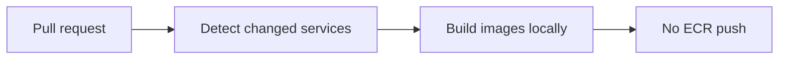
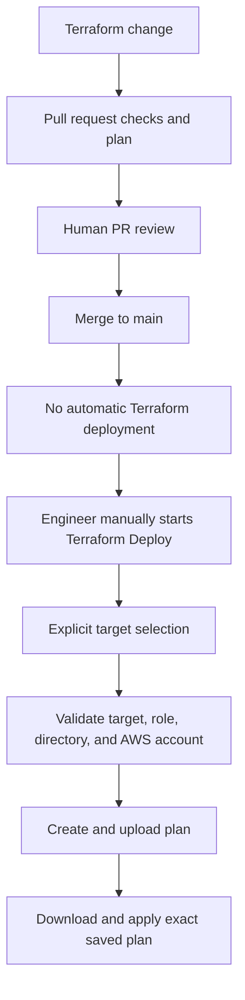

# GitHub Actions Pipelines

This guide describes the current build, Terraform review, and manual deployment workflows.

## Environment separation

| Environment | GitHub Environment | AWS account | Purpose |
|---|---|---:|---|
| DEV | `Development` | `304960797322` | Development and testing |
| PROD | `Production` | `083268669572` | Production |

DEV and PROD are separate AWS accounts. Workflows use explicit environment-to-role mappings and fail if the authenticated account is not the expected account. Image publishing also checks the ECR registry before pushing.

## Build and image publishing

Workflow: [build.yaml](../../.github/workflows/build.yaml)

### Pull requests

For changed services, the workflow builds images locally and never authenticates to AWS or pushes to ECR. Changes outside supported service directories do not select services. The Trivy scan step is currently commented out, so no image scan runs at this time.



### Pushes to `main`

When service paths change on `main`, the workflow detects only the changed services and publishes those images to **DEV only**. Changes outside supported service directories, including workflow-file-only changes, do not select services. Its target is explicitly `Development`, using the DEV ECR role/account. It checks the STS account after authentication and checks the ECR registry after login and again before pushing.

PROD is never selected automatically.

### Manual publishing

`workflow_dispatch` requires an explicit `dev` or `prod` choice. The selected target determines the GitHub Environment and expected role, account, and registry; it does not select or rebuild all services. The workflow detects service changes between the selected commit and its first parent, then builds and pushes only the changed supported services. Multiple changed services are built and pushed in the same run, and unchanged services are not rebuilt or pushed. The workflow validates the target mapping and `AWS_ROLE_ARN` before authenticating, then verifies AWS identity and ECR registry before building/pushing.

| Selection | GitHub Environment | AWS account | IAM role | ECR registry |
|---|---|---:|---|---|
| `dev` | `Development` | `304960797322` | `arn:aws:iam::304960797322:role/bravo-github-ecr` | `304960797322.dkr.ecr.eu-west-2.amazonaws.com` |
| `prod` | `Production` | `083268669572` | `arn:aws:iam::083268669572:role/bravo-prod-github-ecr` | `083268669572.dkr.ecr.eu-west-2.amazonaws.com` |

Production publishing remains explicit and manual only. Unknown selections fail rather than choosing an account. The ECR URI uses the authenticated registry; account and registry are both checked again immediately before `docker push`.

## Terraform PR checks

Workflow: [terraform-pr.yaml](../../.github/workflows/terraform-pr.yaml)

This is the Terraform review and planning stage. Static formatting and Checkov checks run for matching pull requests; path detection then selects only affected plan targets. Each target validates its account, role, and directory mapping before AWS authentication, checks the STS account, then runs `terraform init`, `validate`, and `plan`. Plans are shown in the workflow summary for review.

| Changed path | Terraform plans |
|---|---|
| `terraform/environments/dev/**` | DEV environment |
| `terraform/environments/prod/**` | PROD environment |
| `terraform/bootstrap-dev/**` | DEV bootstrap |
| `terraform/bootstrap-prod/**` | PROD bootstrap |
| `terraform/modules/**` | DEV and PROD environment plans |
| `.github/workflows/terraform-pr.yaml` or `terraform-deploy.yaml` | All four targets |
| Multiple paths | Union of the affected targets |

Shared module changes trigger the DEV and PROD environment plans only. Bootstrap plans run only when their corresponding bootstrap paths change, or when a Terraform workflow change requires all four targets to be validated. For multiple changed paths, the workflow runs the union of the targets affected by each path. PR plans use the DEV or PROD Terraform PR role according to the target:

- DEV: `arn:aws:iam::304960797322:role/bravo-github-terraform-pr`
- PROD: `arn:aws:iam::083268669572:role/bravo-prod-github-terraform-pr`

`terraform-pr.yaml` never runs `terraform apply`.

## Terraform deployment

Workflow: [terraform-deploy.yaml](../../.github/workflows/terraform-deploy.yaml)

Terraform deployment is **not automatic after merge**. `workflow_dispatch` is its only trigger. An engineer deliberately starts the workflow and selects one required target; there is no default target.

| Target | Terraform directory | AWS account | IAM role |
|---|---|---:|---|
| `dev` | `./terraform/environments/dev` | `304960797322` | `arn:aws:iam::304960797322:role/bravo-github-terraform-deploy` |
| `prod` | `./terraform/environments/prod` | `083268669572` | `arn:aws:iam::083268669572:role/bravo-prod-github-terraform-deploy` |
| `bootstrap-dev` | `./terraform/bootstrap-dev` | `304960797322` | `arn:aws:iam::304960797322:role/bravo-github-terraform-deploy` |
| `bootstrap-prod` | `./terraform/bootstrap-prod` | `083268669572` | `arn:aws:iam::083268669572:role/bravo-prod-github-terraform-deploy` |

The plan and apply jobs independently resolve the explicit target and verify the authenticated AWS account before Terraform initializes. The plan job creates and uploads `tfplan`; the apply job downloads that run's target-specific artifact and applies the exact saved plan. Unsupported targets fail.



PR review is the human review stage; manually starting `workflow_dispatch` is the deliberate deployment action. Terraform deployment does not use GitHub Environment required-reviewer protection.

## Fail-closed safety

```text
DEV     → DEV role → account 304960797322 → DEV resources
PROD    → PROD role → account 083268669572 → PROD resources
INVALID → fail
```

Separate AWS accounts and roles, explicit target mappings, STS account checks, and (for image pushes) ECR registry checks prevent a selection from silently falling back to the other environment. PR workflows cannot apply Terraform; deployments require a manual trigger and apply the saved plan.

## Quick reference

| Pipeline | Trigger | DEV | PROD | Can modify AWS? |
|---|---|---|---|---|
| Build PR | Pull request | Changed-service local build | Changed-service local build | No |
| Build on `main` | Push to `main` | Automatic DEV ECR publishing | Never automatic | DEV ECR only |
| Build manual | `workflow_dispatch` | Changed services to DEV ECR | Changed services to PROD ECR (manual only) | ECR only |
| Terraform PR | Pull request | Affected DEV plans | Affected PROD plans | No apply |
| Terraform Deploy | `workflow_dispatch` | Explicit `dev` / `bootstrap-dev` | Explicit `prod` / `bootstrap-prod` | Yes |
